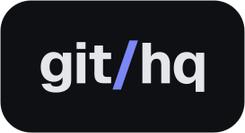
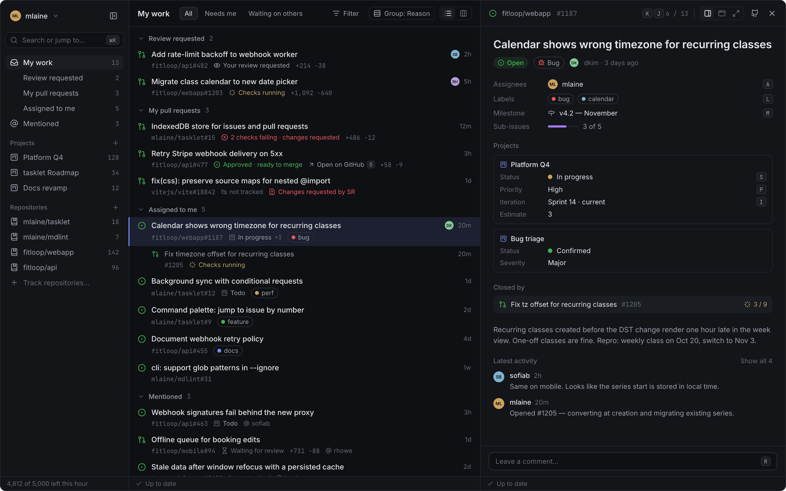

<div align="center">

<a href="https://githq.dev"></a>

A keyboard-first client for GitHub Issues, pull requests and Projects.

[githq.dev](https://githq.dev) · [Design](docs/design/githq/README.md) · [Issues](https://github.com/kedrzu/githq/issues)

[](https://github.com/kedrzu/githq/actions/workflows/deploy.yml)
[](LICENSE)

</div>



## Why

GitHub is a fine place to keep issues: next to the code, open to contributors, free. It is a slow place to work
them. Every view is a page load, there is no single list of what concerns you across repositories, and the
mouse is never optional. The usual answer is a dedicated tracker, which means a second tool, a sync, and seats
to pay for.

githq is the other answer: a fast client for the tracker you already have. It shows what GitHub has and
nothing else, and every change you make is an ordinary GitHub change, visible on github.com at once.

## What it does

- **My work** — issues assigned to you, your pull requests with checks and reviews, reviews waiting on you and
  mentions, from every repository, including other people's.
- **Repositories and Projects** — tracked repositories and GitHub Projects as lists or boards, with the
  fields, views and iterations each project defines.
- **Keyboard first** — a command menu (<kbd>⌘</kbd> <kbd>K</kbd>) and single-key actions on the selected
  items.
- **Instant** — screens open from a copy in your browser; edits show at once and are written to GitHub behind
  the scenes.
- **Same addresses** — replace `github.com` with `githq.dev` in a link to an issue, pull request or list.

There is more on [githq.dev](https://githq.dev).

## How it works

githq is a single-page app that talks to GitHub's GraphQL API straight from your browser. What you work on is
kept in IndexedDB as a cache that can always be rebuilt from GitHub; tracked repositories and projects are
refreshed with conditional REST requests, which cost nothing from your rate limit when nothing changed.

The app is static files on Cloudflare. The only code that runs on a server is one stateless Worker that trades
GitHub's OAuth code for a token, because GitHub's token endpoint needs the client secret. It has no database and never sees your
issues. The design and every decision behind it, with the evidence, are in
[`docs/design/githq/`](docs/design/githq/README.md) and [`DECISIONS.md`](docs/design/githq/DECISIONS.md).

## Permissions and privacy

githq is a GitHub OAuth App. It asks for three scopes and needs all of them:

- `repo` — read and edit issues and pull requests, private ones included. GitHub has no narrower scope for
  that, so the consent screen reads as full repository access; githq touches only issues, pull requests and
  projects.
- `project` — read and edit GitHub Projects.
- `read:org` — list your organizations, to filter by owner and to tell which one hides its private data.

Your token stays in your browser's `localStorage`, and your data goes from the browser to `api.github.com`.
The Worker handles the code and the token in memory during sign-in, stores nothing and logs neither;
Cloudflare's own request logs still record that a request happened. The app has no analytics. You can revoke
access at any time under GitHub → Settings → Applications → Authorized OAuth Apps. An organization that
restricts OAuth Apps keeps its private repositories hidden until an owner approves githq.

## Status

githq is young and moving fast. It is planned in the open in
[GitHub Issues](https://github.com/kedrzu/githq/issues) and worked from githq itself. Expect rough edges, and
please report them.

## Development

A Nuxt 4 single-page app and one Cloudflare Worker, on bun workspaces and Nx.

```sh
bun run setup   # install, generate, build
bun run dev     # the app on http://localhost:8787
```

Without OAuth credentials in `.env` (template: `.env.example`), the sign-in screen of a development build
takes a personal token — `gh auth token` works. The rest of the commands, the checks and how we work are in
[`AGENTS.md`](AGENTS.md).

## Security

Please report vulnerabilities privately through
[GitHub's private vulnerability reporting](https://github.com/kedrzu/githq/security/advisories/new), not in
public issues.

## License

Copyright 2026 Michał Kędrzyński.

githq is free software under the [GNU Affero General Public License v3.0](LICENSE): use it, change it and run it
for any purpose, commercial included. If you run a modified githq as a service for others, you must offer them
its source under the same license.

Want to use githq under different terms (for example inside a company whose policy rules out the AGPL)?
A commercial license is available: open an issue or write to the author.

The license covers the code only, not the githq name, logo or the githq.dev domain: a fork ships under its own name.

## Contributing

Contributions are welcome. Before your first pull request is merged you sign the
[Contributor License Agreement](CLA.md) by leaving a comment on the pull request; a bot asks for it. You keep
the copyright to your contribution; the agreement lets githq also offer it under the commercial license.

<br>

<div align="center"><sub>githq is not affiliated with GitHub, Inc.</sub></div>
