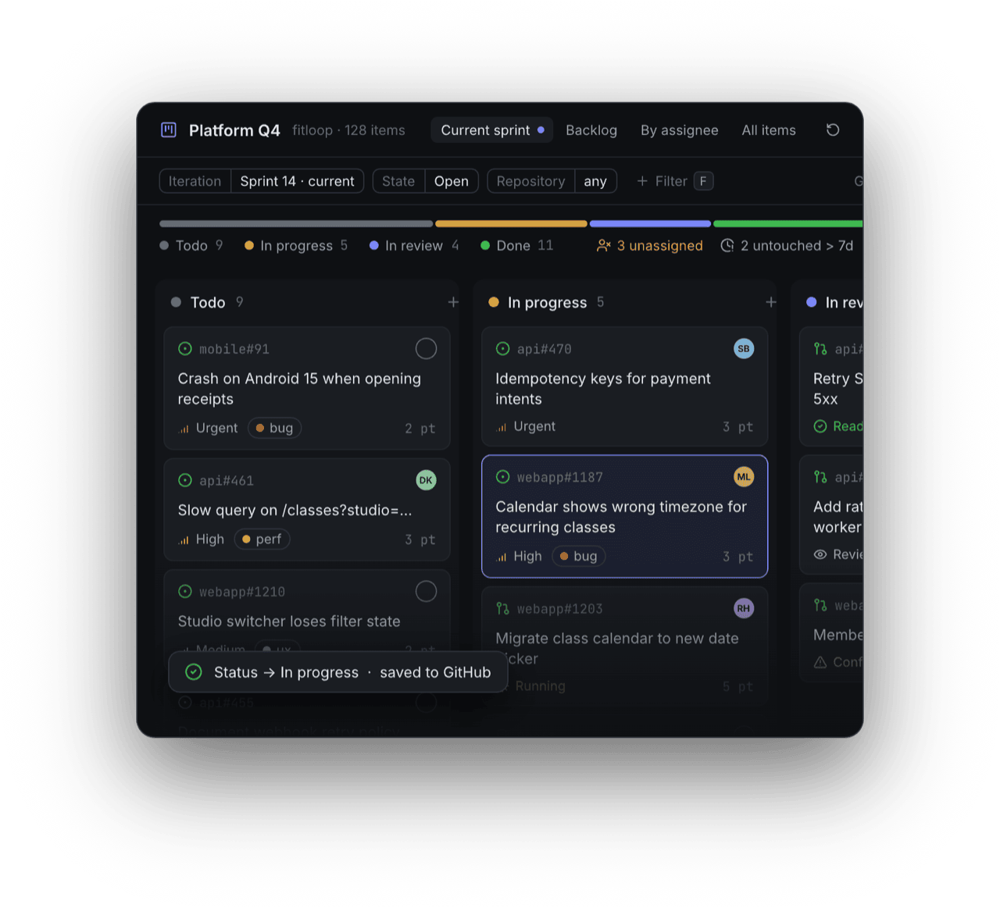
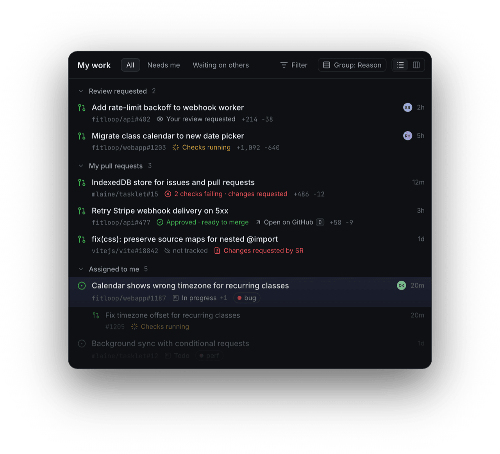
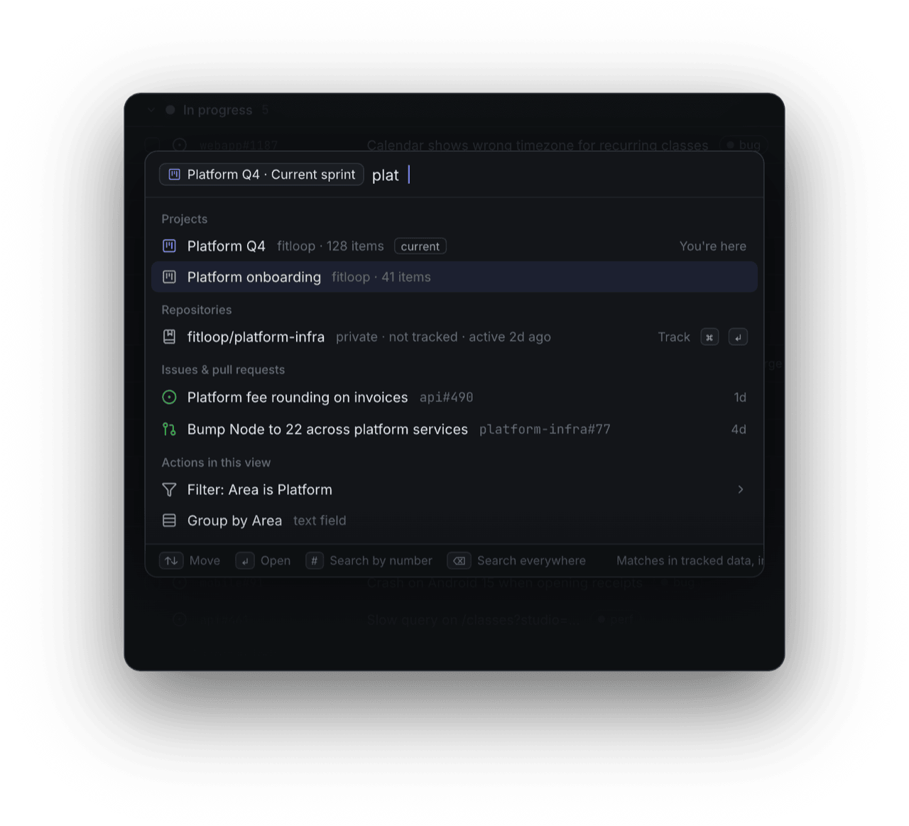
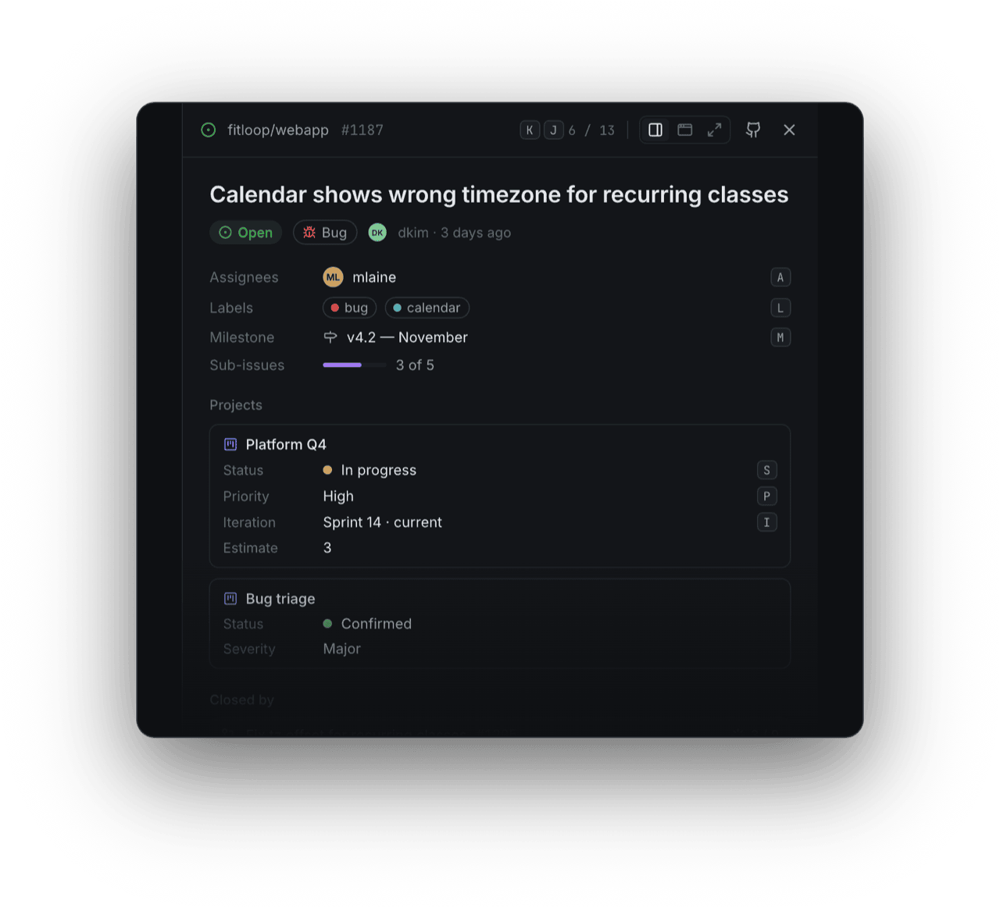

<div align="center">

<a href="https://githq.dev"></a>

# githq

### Your GitHub issues, at the speed of thought.

A keyboard-first task manager on top of GitHub Issues and Projects.<br>
Linear’s speed, GitHub’s data — free, open source, and nothing to keep in sync.

[](https://githq.dev)
[](https://github.com/kedrzu/githq/stargazers)
[](https://github.com/kedrzu/githq/actions/workflows/deploy.yml)
[](LICENSE)

**[Sign in with GitHub](https://githq.dev)** · [Features](#features) · [Why githq](#why-githq) · [Development](#development)

<sub>No install · No new tracker · Nothing stored outside GitHub</sub>

<br>


</div>

<br>

**Built on what your team already uses:** Issues · Pull requests · Projects · Labels · Milestones · Iterations · Assignees

## Not another tracker. A faster way to work the one you already have.

Every issue, label and project field stays on GitHub, where your code and your contributors already are.
githq doesn’t import, mirror or own any of it — it just makes working it feel instant. Every change you make
here is an ordinary GitHub change, on github.com the same second.

## Features

### ⚡ Instant isn’t a feature. It’s the whole point.

githq keeps a copy of your GitHub work in the browser and refreshes it in the background. Screens open from
that copy and edits land before GitHub even answers. There is no spinner between you and the next issue.

- Every screen opens from a local copy
- Edits show at once, written to GitHub behind the scenes
- Background refresh on GitHub’s free “not modified” answers

<p align="center"></p>

### 📥 Everything that’s yours. Every repo. One screen.

Issues assigned to you, your pull requests with their CI and review state, the reviews waiting on you, the
projects you track. A pull request that closes your issue sits right under it, so the same work never shows
up twice.

- Assigned issues across every repository
- Your PRs: checks, reviews, draft, mergeable
- Reviews requested from you, front and center

<p align="center"></p>

### ⌨️ Your hands never leave the keyboard.

<kbd>⌘</kbd> <kbd>K</kbd> finds any issue, repository or action. A single key sets the status, assignee or
labels of whatever is selected — one item or twenty. Another opens it on github.com when it’s time to read
the diff.

|Key|Action|
|-|-|
|<kbd>⌘</kbd> <kbd>K</kbd>|Command menu|
|<kbd>C</kbd>|New issue|
|<kbd>S</kbd>|Set status|
|<kbd>A</kbd>|Assignee|
|<kbd>L</kbd>|Labels|
|<kbd>O</kbd>|Open on GitHub|

<p align="center"></p>

### 🐙 GitHub’s model. Linear’s feel.

If your project has a Status field, githq shows that Status. Custom fields, iterations, list or board —
whatever your GitHub Project defines, and nothing githq made up. Change it here and it’s changed on
github.com. And the other way round.

- Projects (v2) fields, views and iterations
- Two-way by design — GitHub is the source of truth
- Every githq address is a GitHub address

<p align="center"></p>

## The details

Small things that add up to a tool you keep open.

- **Swap the host, keep the page.** Change `github.com` to `githq.dev` in any link and the same issue, pull
  request or list opens in githq. Anything githq doesn’t show hands you straight back to github.com.

  ```diff
  - https://github.com/acme/web/issues/42
  + https://githq.dev/acme/web/issues/42
  ```

- **Free. Actually free.** No seats, no plans, no trial that runs out. GitHub is the backend, so there is
  nothing for us to charge you for.

- **No server holds your work.** You sign in with GitHub and that’s it. Your work lives on GitHub and in your
  browser — githq has no database of its own.

- **Gentle on your API limit.** Change checks use GitHub’s conditional requests. When nothing changed, they
  don’t count against your hourly allowance.

- **Installs like an app.** Add githq to your dock or home screen. It opens straight into your work, in its
  own window.

- **Anywhere on GitHub.** The pull request you opened on someone else’s open-source project shows up too. If
  it concerns you, it’s in your work — no matter whose repository.

- **Reviews stay where diffs belong.** githq tells you when a pull request is ready: checks, reviews,
  mergeable. One key opens it on github.com for the review.

## Why githq

The best of both. Without the second tool.

||github.com|A dedicated tracker|**githq**|
|-|:-:|:-:|:-:|
|Your work lives next to your code|✅|❌|✅|
|Instant — no spinner on navigation|❌|✅|✅|
|Everything from the keyboard|Partly|✅|✅|
|All your repositories in one view|Partly|✅|✅|
|Nothing to import or keep in sync|✅|❌|✅|
|Price for your team|Free|Per seat|**Free**|

## Built in the open. On GitHub, obviously.

Every line of githq, every design decision and every issue is public. It’s planned in
[GitHub Issues](https://github.com/kedrzu/githq/issues) — and worked from githq itself. Read the code, open an
issue, send a pull request. githq is young and moving fast: the design behind it is in
[`docs/design/githq/`](docs/design/githq/README.md), with every decision and its reasons in
[`DECISIONS.md`](docs/design/githq/DECISIONS.md).

If githq makes your day on GitHub faster, a ⭐ helps others find it.

## Development

A Nuxt 4 single-page app and one Cloudflare Worker, on bun workspaces and Nx; GitHub’s GraphQL API is the
only backend.

```sh
bun run setup   # install, generate, build
bun run dev     # the app on http://localhost:8787
```

Without OAuth credentials in `.env` (template: `.env.example`), the dev sign-in screen takes a personal
token — `gh auth token` works. The rest of the commands, the checks and how we work are in
[`AGENTS.md`](AGENTS.md).

## License

Copyright 2026 Michał Kędrzyński.

githq is free software under the [GNU Affero General Public License v3.0](LICENSE): use it, change it and run it
for any purpose, commercial included. If you run a modified githq as a service for others, you must offer them
its source under the same license.

Want to use githq under different terms (for example inside a company whose policy rules out the AGPL)?
A commercial license is available: open an issue or write to the author.

The license covers the code only, not the githq name, logo or the githq.dev domain: a fork ships under its own name.

## Contributing

Contributions are welcome. Before your first pull request is merged you sign the
[Contributor License Agreement](CLA.md) by leaving a comment on the pull request; a bot asks for it. You keep
the copyright to your contribution; the agreement lets githq also offer it under the commercial license.

<br>

<div align="center"><sub>githq · GitHub Issues, at the speed of thought · Not affiliated with GitHub, Inc.</sub></div>
